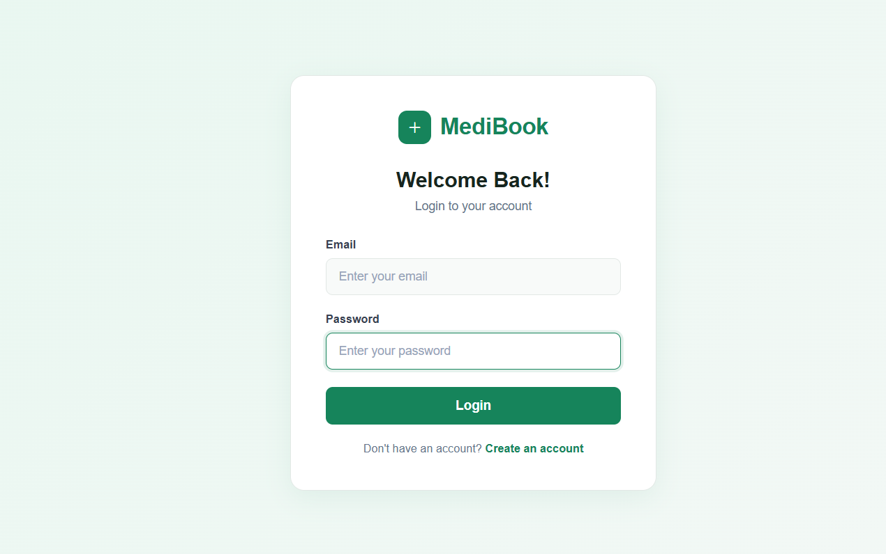
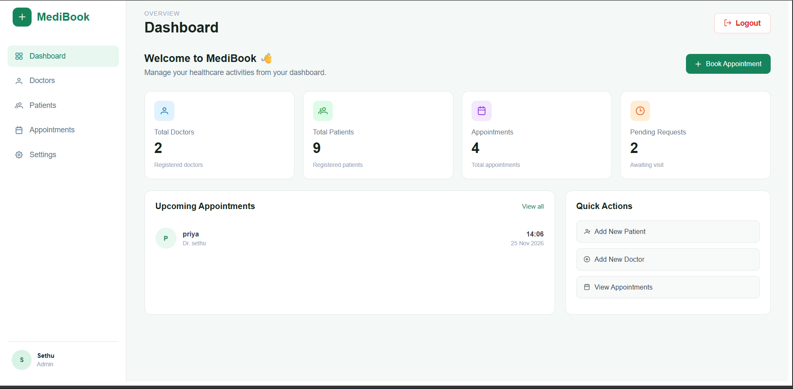
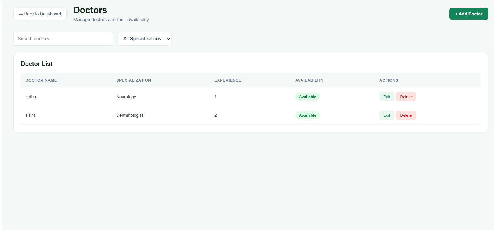
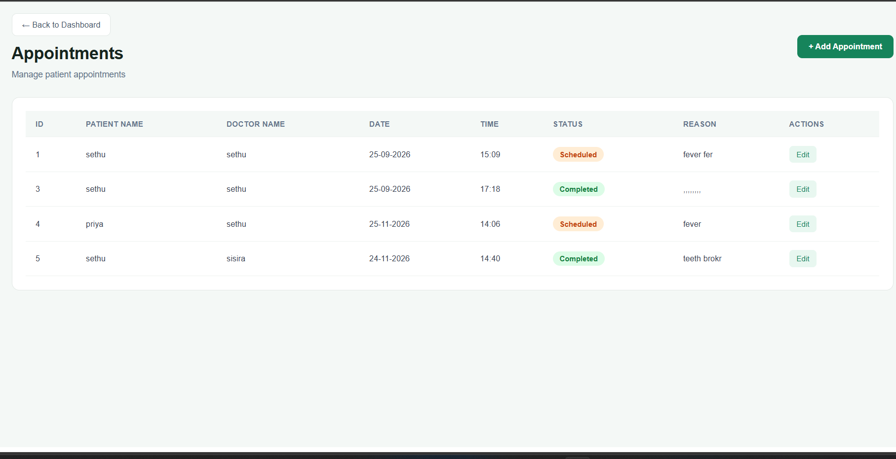

# MediBook – Healthcare Appointment Management System

A full-stack web application to manage healthcare appointments digitally, built with **Angular**, **ASP.NET Core Web API** and **SQL Server**.

## Screenshots


| Login | Dashboard |
|-------|-----------|
|  |  |

| Doctors | Appointments |
|---------|--------------|
|  |  |

## Features

**Authentication & Security**
- Patient registration and login with email and password
- Password hashing
- JWT token generation and validation
- Angular HTTP Interceptor to attach the token to API requests
- Auth Guard to protect routes
- Logout

**Role-Based Access**

| Role | Permissions |
|------|-------------|
| Admin | Manage doctors, patients and appointments |
| Doctor | View assigned appointments and related patients; update appointment status |
| Patient | View own information and appointments; book and edit own appointments |

**Doctor Management:** add, view, edit and delete doctors; create doctor login accounts; manage availability.

**Patient Management:** patient registration, view and search patients, update permitted personal details.

**Appointment Management:** book appointments by selecting doctor, date/time and reason; view and edit appointments; role-based access; doctors can update appointment status.

**Dashboard & UI:** dashboard statistics, sidebar navigation, form validation and user feedback.

## Tech Stack

| Layer | Technologies |
|-------|--------------|
| Frontend | Angular, TypeScript, HTML5, CSS3, Angular Router, Reactive Forms, PrimeIcons |
| Backend | C#, ASP.NET Core Web API, REST API, JWT Authentication |
| Database | SQL Server, Entity Framework Core |
| Tools | Swagger, Postman, Git, GitHub |

## Database

SQL Server database `MediBookDb` with 4 tables:

| Table | Purpose |
|-------|---------|
| Users | Login credentials and roles |
| Doctors | Doctor details |
| Patients | Patient details |
| Appointments | Appointment details and relationships |

A patient and a doctor can each have many appointments. Users links login accounts to Doctor or Patient profiles.

## Project Structure

```
MediBook.Api/
├── Controllers/   (Auth, Doctors, Patients, Appointments)
├── Models/
├── Dtos/
├── Data/
├── Program.cs
└── appsettings.json

medibook-frontend/
└── src/app/
    ├── pages/     (login, register, dashboard, doctors, patients, appointments, settings)
    ├── service/   (auth, interceptor, doctor, patients, appointments)
    ├── app.routes.ts
    └── app.config.ts
```

## Getting Started

### Prerequisites
- .NET SDK
- Node.js and Angular CLI
- SQL Server

### Backend
```bash
cd MediBook.Api
# Set your connection string and JWT key in appsettings.json
dotnet ef database update
dotnet run
```
Swagger UI is available at `https://localhost:<port>/swagger`.

### Frontend
```bash
cd medibook-frontend
npm install
ng serve
```
Open `http://localhost:4200`.

## API Overview

| Controller | Responsibility |
|------------|----------------|
| AuthController | Register and login |
| DoctorsController | Doctor APIs |
| PatientsController | Patient APIs |
| AppointmentsController | Appointment APIs |

## Roadmap
- Pagination and advanced filtering
- Deployment
- End-to-end testing

## Author

**Sethulakshmi K** – [LinkedIn](https://linkedin.com/in/sethulakshmi663) | [GitHub](https://github.com/Sethulakshmi663)
